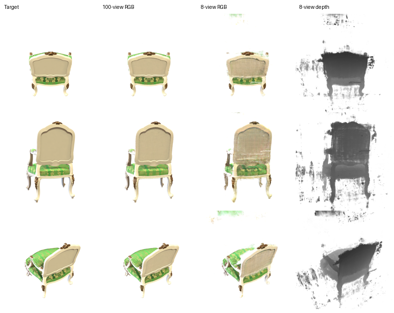

# Chair at 75,000 updates

Both vanilla runs used seed 42, the frozen two-phase schedule and the same 25 official Blender test cameras at 400 × 400. Metrics are means over views. LPIPS uses calibrated AlexNet v0.1.

| Training views | PSNR, dB ↑ | SSIM ↑ | LPIPS ↓ | Foreground PSNR, dB ↑ |
| --- | ---: | ---: | ---: | ---: |
| 100 | 31.706 | 0.9641 | 0.0364 | 24.894 |
| 8 | 24.930 | 0.8959 | 0.1078 | 18.374 |

Dense vanilla led eight-view vanilla by **6.777 dB**. A paired bootstrap of the 25 camera indices gave a 95% interval of **5.624–7.894 dB** (10,000 draws, seed 42). This interval describes variation across the evaluated views for this training seed. The eight-view model scored **32.876 dB** on its training cameras. The all-white control scored **14.085 dB** on the full held-out images.

The matched regularised run stopped at update 128. Its bounded replay and the diagnostic variants remained white at 500. Gap recovery is unavailable because the regularised arm has no matched endpoint. [Training evidence](stage13-health.json)

The rows below show test frames r_0, r_96 and r_192. The eight-view RGB shows streaks on the chair back and stray colour above it. The depth map places density outside the silhouette.

[Per-view metrics](held-out.csv) · [Full-size target, RGB, depth and opacity PNGs for both arms](held-out-examples.zip) · [Endpoint identities and measurements](stage14-results.json)
